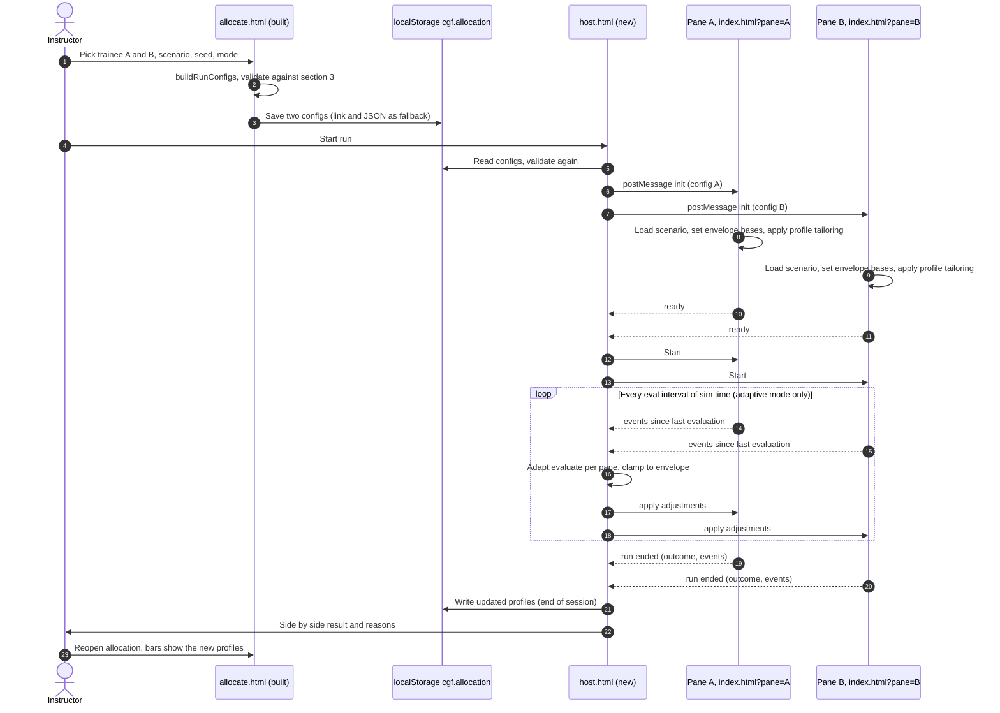
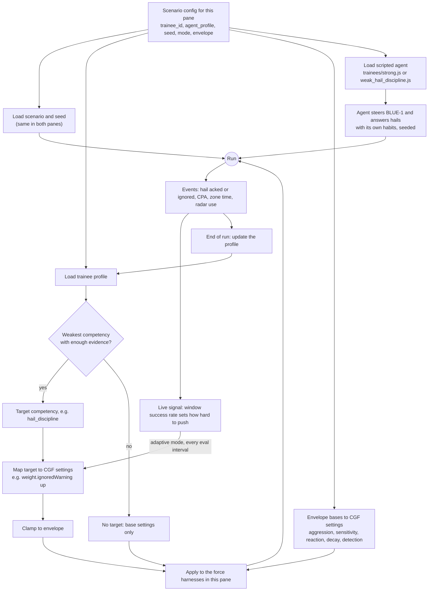

# Hackathon: linking the allocation page to the run (plan)

**Summary**: The simulation run takes its inputs from the trainee allocation. Each pane starts from the scenario config that `allocate.html` produced, and the CGFs in that pane are tailored to that pane's trainee. This page is the plan and the workflow diagrams.

**Status (2026-10-29): phase 1 built and pushed to `main`** (commits `09873ef` and `999dcc1`), separated from the runtime so JL and Devin can work at the same time. The sections below are the original plan; this block says what was built.

- **Built**: `host.html` (two panes, Start, Pause and Restart both), `link/host.js`, `link/host.css`, `link/pane.js` (the adapter that runs inside the runtime), `contracts/link.js` (the message contract), `tests/link.html`, `link/README.md` (ownership, the runtime API the link depends on, protocol, how to test). `allocate.html`'s "Start run" now saves the allocation and opens `host.html`.
- **The one shared touch point** is one tag in `runtime.html`: ``, committed on its own (`999dcc1`) so it can be seen or reverted. It does nothing unless the page is a `?pane=` iframe. **JL needs to tell Devin about it.**
- **Checked**: `tests/link.html` passes 27 of 27 in Chrome. It loads the real `runtime.html` in an iframe and walks hello, init, ready, start, pause and restart, plus bad inputs and a runtime opened on its own (it sends nothing). I also drove the whole flow in Chrome: pick six trainees on the allocation page, press Start run, and both panes loaded, ran to about 7:44 of sim time in 8 s, paused, and restarted to 0:00. Not run in Edge.
- **What a pane does with its trainee today**: loads the scenario, shows an overlay with the platform and its crew, and reports status. Because the runtime has no scripted trainee agent and no tailoring yet, **the two panes still play identically** until those exist (R3 and R4).
- **Not applied on purpose**: the allocation's envelope. Its default values (aggression 0.4, sensitivity 0.5, reaction 8 s) are on a different scale from the runtime's own (1, 1 and 30 s); applying them would cut tension build-up to about a fifth and runs might never escalate. The pane records the envelope on `CGF.sim.link.envelope` only. **Open for the Lead**: re-base the envelope fixture, or map it relative to the runtime defaults.
- **Hook for tailoring (R3)**: the Engine lane subscribes to the `link-init` event (`CGF.on('link-init', config => ...)`) and needs no change to `link/pane.js`.
- **Answers to the three questions below, as built**: phase 1 only (R1 and R2, with the hook for R3); one tag in `runtime.html` rather than a copied page, so Devin's changes reach the linked panes; JL's session built `host.html`.
- **Still open**: the envelope scale above, and the rule for a crew's "weakest competency" (INTERFACES §11).

**Last updated**: 2026-10-29

**Changes since this plan was drawn (same day)**, read the diagrams and tasks below with these:
- **The simulator page is `runtime.html`.** The Lead session renamed `index.html` to `runtime.html` (commit `f97f9ed`). Wherever this page says `index.html`, read `runtime.html`.
- **The page's output is an `Allocation`** (INTERFACES §3.1), not two bare configs. `buildRunConfigs` became `buildAllocation`, and the run page calls `CGF.contracts.expandAllocation` to get one config per pane. `cgf.allocation` holds the `Allocation`, and the `?alloc=` link carries it too.
- **Each pane is a crew, not one trainee.** The config has `platform` (fighter, warship or tank) and a `crew` with one entry per seat (2, 3 or 2 seats). So the "trainee id in each pane's header" in R1 becomes the crew list, and the profile tailoring in R3 runs per seat. How a crew's weakest competency is chosen is an open question for the Lead, noted on [[user/projects/Hackathon/allocation-page]].
- **The scenario follows the platform type** (air, sea or land), so the host must load the scenario named in the config, not assume `strait-transit`.

---

## Checked before planning

- Under `file://`, a value saved to `localStorage` by one page is readable from another page, in both Chrome and Edge. This closes task A0 from [[user/projects/Hackathon/allocation-page]].
- An iframe can `postMessage` to its parent. Reaching into the iframe's DOM is blocked (SecurityError). So a two-pane host page built from iframes of `index.html` is feasible, and everything must go through messages.
- The engine has no randomness. `seed` is recorded in the run but changes nothing until the scripted trainee agents (which use it) exist.
- `CGF.loadScenario(id, harnessOverrides, {mode})` starts a run. Its `mode` is exercise or freeplay, which is not the allocation's adaptive or fixed. The two are separate settings.

## Workflow, end to end

## What makes a run depend on its trainee

## Phases

| Phase | ID | Task | Lane | Acceptance |
|---|---|---|---|---|
| 1. The link | R1 | `host.html`: two iframes of `index.html`, reads `cgf.allocation` (or `?alloc=`), validates, sends `init` to each pane, Start and Pause for both | Lead | Two panes load the same scenario; trainee ids show in each pane's header |
| 1 | R2 | `js/pane.js`: pane side of the messages. On `init`: load the scenario, store the config on `CGF.sim`, put the envelope bases into `CGF.params`, show the trainee id and seed, tag the CGF log. Needs one `<script>` tag in `index.html`; it does nothing unless the page has `?pane=` | Console | Opened on its own, `index.html` behaves exactly as before |
| 1 | R3 | `js/adapt/tailor.js`: weakest competency with enough evidence, mapped to setting nudges, clamped to the envelope, applied to the pane's harness weights. A stub that Engine's E4 replaces | Engine | Panes A and B start with different CGF settings, and the log says why |
| 2. Real trainees | R4 | Scripted agents `trainees/strong.js` and `trainees/weak_hail_discipline.js` (Sim S3) so each pane runs unattended and the weakness shows in behaviour | Sim | The weak agent ignores hails far more often than the strong one |
| 3. Close the loop | R5 | End of run: update each profile in `localStorage`; the allocation page reads saved profiles over the fixtures | Engine, Console | Bars on the allocation page move after a run |
| 3 | R6 | Live evaluation every interval (E4 policy, live signal) | Engine | Pressure follows the trainee's current success rate |

## Open questions

1. How far to go now: phase 1 only, or phases 1 and 2? Without R4 the panes start differently but nobody drives the ships.
2. `index.html` gets one new script tag (R2). Adding it is the only way to hook the pane, because the host cannot reach into an iframe. The alternative is a copied `pane.html`, which avoids touching the file but duplicates its layout and drifts when Devin edits `index.html`.
3. `PLAN.md` §7 gives hosting the panes to the Lead (C1, L2). Is it fine for this session to build `host.html` anyway?
